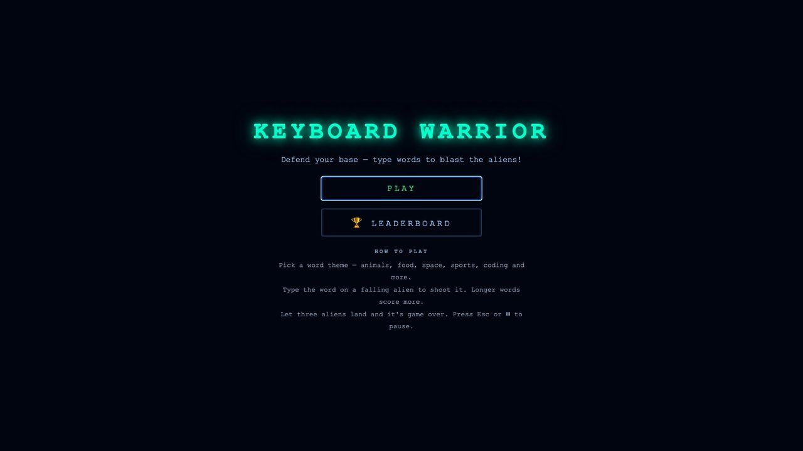
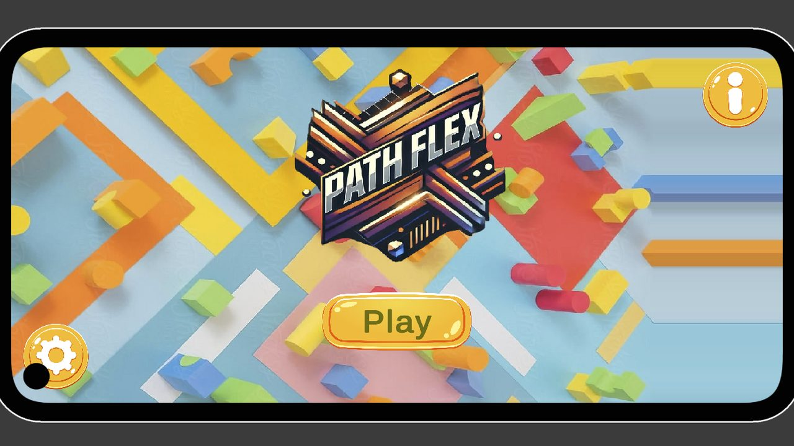
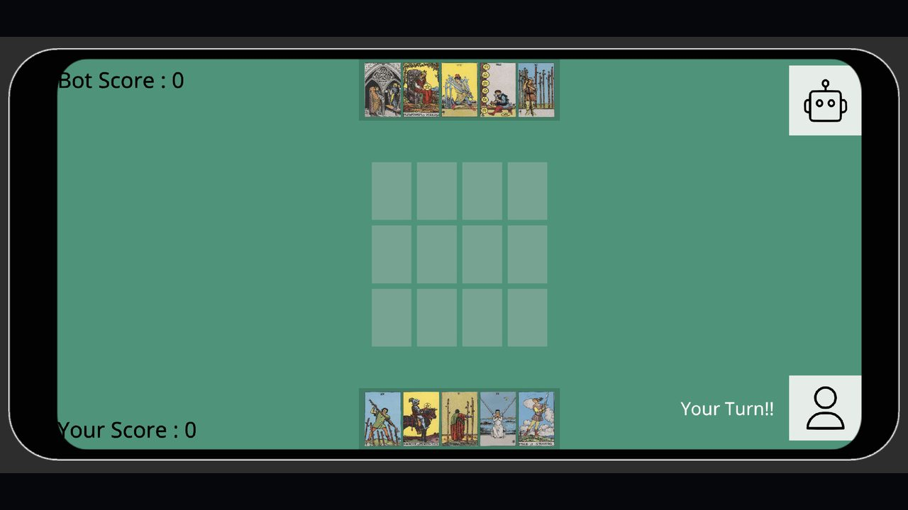
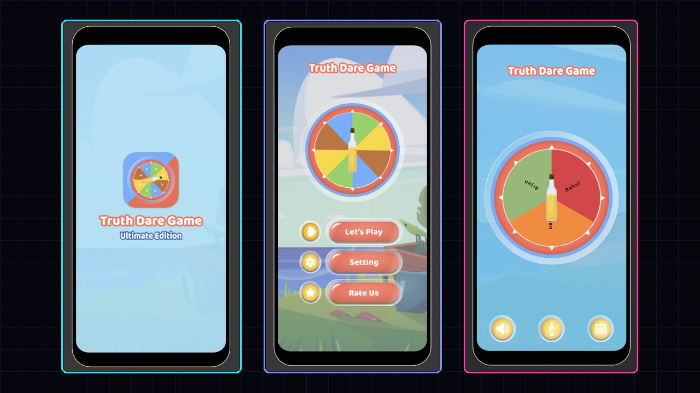
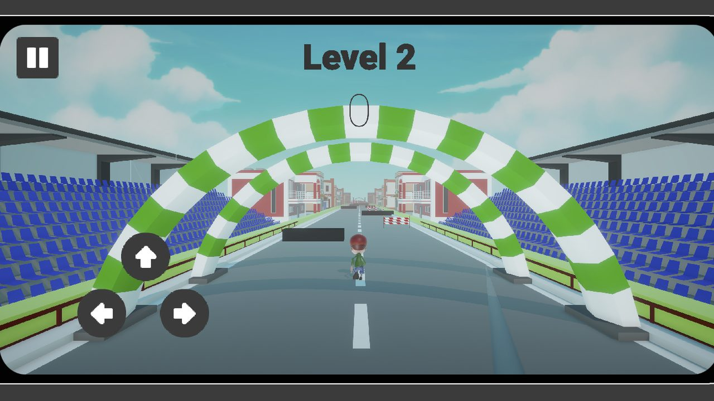
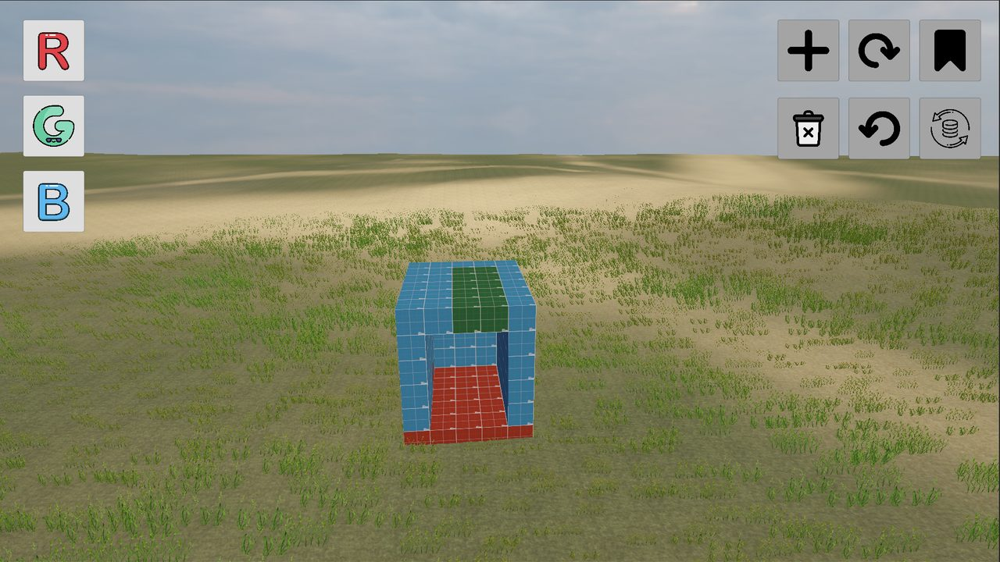

<a href="https://rahulwalia-portfolio.vercel.app">
  
</a>

<p align="center">
  <a href="https://rahulwalia-portfolio.vercel.app"></a>
  <a href="https://www.linkedin.com/in/rahulwalia-ai/"></a>
  <a href="https://x.com/rahulwalia_ai"></a>
  <a href="mailto:rahulwalia5740@gmail.com"></a>
  <a href="https://rahulwalia-portfolio.vercel.app/Assets/Resume/Resume_RahulWalia.pdf"></a>
</p>

---

## 🎮 Player card

I'm a **Unity developer** from Delhi who builds games and real-time 3D tools. These days I'm a **Software Engineer at Square Yards**, working on **Blocks**, a real-time 3D interior design platform built in Unity, where I build the object placement, transformation and scene-interaction systems.

```yaml
player:   Rahul Walia
class:    Unity Developer · Game Creator
guild:    Square Yards — Software Engineer
quest:    Blocks, real-time 3D interior design in Unity
base:     Delhi, India
loadout:  [Unity, C#, URP, DOTween, TextMesh Pro, Figma]
motto:    Games that are fun to play and clean to maintain.
```

---

## 🕹️ Play my games

Every one of these runs in your browser. Click a screenshot to jump in.

<table>
  <tr>
    <td width="50%" valign="top">
      <a href="https://keyboardwarrior-five.vercel.app/"></a>
      <h3>⌨️ Keyboard Warrior</h3>
      Defend your base by typing the words on falling aliens. 12 word themes, 3 difficulties, desktop and mobile, with a live global leaderboard.
      <br><br>
      <code>React</code> <code>Vite</code> <code>Serverless API</code> <code>Vitest</code>
      <br><br>
      <a href="https://keyboardwarrior-five.vercel.app/"></a>
    </td>
    <td width="50%" valign="top">
      <a href="https://play.unity.com/en/games/444d51d3-1752-41bc-a1d5-56857558c5c9/path-flex"></a>
      <h3>🧩 Path Flex</h3>
      Steer through adaptive paths and interactive obstacles to unlock new levels, with difficulty that ramps up as you go.
      <br><br>
      <code>Unity</code> <code>C#</code> <code>Game Design</code> <code>Level Design</code>
      <br><br>
      <a href="https://play.unity.com/en/games/444d51d3-1752-41bc-a1d5-56857558c5c9/path-flex"></a>
    </td>
  </tr>
  <tr>
    <td width="50%" valign="top">
      <a href="https://play.unity.com/en/games/511d6bd8-91fb-4534-a678-d9959faf1efc/card-war"></a>
      <h3>🃏 Card War</h3>
      Go head to head with a bot. Each round the higher card wins the point, so keep your best cards for the right moment.
      <br><br>
      <code>Unity 2D</code> <code>C#</code> <code>Game Design</code>
      <br><br>
      <a href="https://play.unity.com/en/games/511d6bd8-91fb-4534-a678-d9959faf1efc/card-war"></a>
    </td>
    <td width="50%" valign="top">
      <a href="https://play.unity.com/en/games/faa8980d-ab79-41fc-99fd-b789ab5d8d32/truth-dare"></a>
      <h3>🎡 Truth &amp; Dare</h3>
      A party game with separate question sets for Kids, Teens and Adults, so it's fun and safe for every group.
      <br><br>
      <code>Unity 2D</code> <code>C#</code> <code>Mobile UI</code>
      <br><br>
      <a href="https://play.unity.com/en/games/faa8980d-ab79-41fc-99fd-b789ab5d8d32/truth-dare"></a>
    </td>
  </tr>
  <tr>
    <td width="50%" valign="top">
      <a href="https://play.unity.com/en/games/d05a2286-2be3-403a-8897-1dfc51bb097b/escape-route"></a>
      <h3>🏃 Escape Route</h3>
      Dodge obstacles, collect points and test your reflexes across levels that keep getting harder.
      <br><br>
      <code>Unity</code> <code>C#</code> <code>WebGL</code> <code>OOP</code>
      <br><br>
      <a href="https://play.unity.com/en/games/d05a2286-2be3-403a-8897-1dfc51bb097b/escape-route"></a>
    </td>
    <td width="50%" valign="top">
      <a href="https://play.unity.com/en/games/39bf2f9c-f5ba-46b9-ba7f-e52695a9dcbf/voxels-crafting"></a>
      <h3>🧱 Voxel Crafter</h3>
      A 3D sandbox where you place, destroy and shape voxel blocks on a dynamic grid.
      <br><br>
      <code>Unity 3D</code> <code>C#</code> <code>WebGL</code> <code>OOP</code>
      <br><br>
      <a href="https://play.unity.com/en/games/39bf2f9c-f5ba-46b9-ba7f-e52695a9dcbf/voxels-crafting"></a>
    </td>
  </tr>
</table>

---

## 🏆 Quest log

| | Role | Where | When |
|:-:|---|---|---|
| 🟢 | **Software Engineer** | Square Yards | Oct 2025 – Present |
| ✅ | **Software Engineer Intern** | Square Yards | Jul 2025 – Oct 2025 |
| ✅ | **Game Developer Intern** | Jabsz Gaming Studios | Sep 2024 – Apr 2025 |
| 🎓 | **B.Tech, Computer Science** | Jamia Hamdard University | 2021 – 2025 |

- **Square Yards, Software Engineer:** building core 3D features for Blocks: object placement, transformation, scene interaction and real-time rendering performance.
- **Square Yards, Intern:** designed and built three Unity mobile games (Last War, Card War, Truth & Dare), covering gameplay, UI/UX, state management and performance.
- **Jabsz Gaming Studios:** UI/UX, gameplay and performance work on mobile and cross-platform games, including [Zombie Rush](https://play.google.com/store/apps/details?id=com.JabszGamingStudios.ZombieRush) on Google Play.

---

## 🛠️ Loadout

<p>
  
</p>

**Unity toolkit:** URP · Input System · TextMesh Pro · DOTween · Animator &amp; Timeline · WebGL builds<br>
**Workflow:** OOP and design patterns · Git · Trello · Figma for game UI

<details>
<summary><b>📜 Certifications</b> (click to expand)</summary>
<br>

- [Complete C# Unity Game Developer 3D](https://www.udemy.com/certificate/UC-f88a678c-9079-406c-95ef-0b17f8d596fe/) · Udemy
- [Unity 2023 Essential Training](https://www.linkedin.com/learning/certificates/2cb992e123b20bc3d457ce413cdabed87557250ffc66a6469151cd962f47254f) · LinkedIn Learning
- [Unity Certified Associate: Scripting with C#](https://www.linkedin.com/learning/certificates/d2bbe12a336157104a61a766432431c8d1005cb4fc22930ba288359c50fffef8) · LinkedIn Learning
- [Unity Certified Associate: Animation & Cinematics](https://www.linkedin.com/learning/certificates/dbd472d91e552c9a01a994c6222864bcee5c8e585d5425b1ecde60f5eab8b553) · LinkedIn Learning
- [Object-Oriented Programming with C#](https://www.linkedin.com/learning/certificates/00814a35e365a3ddfd87667fc82cd745c6a7a47ffa387eef3d18fa56814ae127) · LinkedIn Learning
- [Learning Git and GitHub](https://www.linkedin.com/learning/certificates/bfa20fa3aaafd8bca91f1f315cd70b811243738303b9218a385edd22e3bb9b11) · LinkedIn Learning
- Programming in Modern C++ · SWAYAM (NPTEL)
- [Introduction to Database Systems](https://drive.google.com/file/d/1xWM04TIq0E7nlwG6fXqyvADGXUUjAFDj/view?usp=share_link) · SWAYAM (NPTEL)
- [Data Analytics with Python](https://drive.google.com/file/d/1prVDotkxatoRV3IZ_rCpmmngHGFdJNAG/view?usp=share_link) · SWAYAM (NPTEL)

</details>

---

<p align="center">
  <b>My portfolio is a game too.</b> Run through a 2D side-scrolling city where every project is an arcade cabinet.<br><br>
  <a href="https://rahulwalia-portfolio.vercel.app"></a>
  <br><br>
  <sub>Psst: try ↑ ↑ ↓ ↓ ← → ← → B A once you're in.</sub>
</p>
